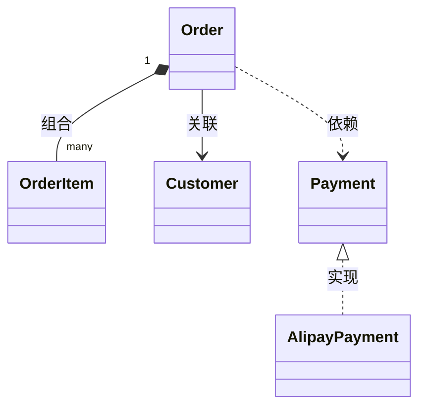

---
tags:
- Java
- SE
- 可信认证
- OOP
---

# 面向对象编程

> 这是华为可信认证的一个科目，本版块梳理面向对象的核心概念、Java 中的落地机制，以及从语法到设计的进阶方向。

面向对象编程（Object-Oriented Programming，OOP）不是"把每个名词都写成一个类"，而是一种**组织复杂度**的方法：把状态和行为封装在对象里，通过接口约定对象之间的协作，让变化被限制在局部。

学习 OOP 容易停留在语法：会写 `class`、会 `extends`、会用 `interface`，但遇到需求变化时仍然写出牵一发动全身的代码。本页先从概念地图入手，再给出 Java 中的关键机制和常见误区，最后给出学习方向。

## 概念地图

| 概念 | 一句话解释 | 真正要解决的问题 |
| --- | --- | --- |
| 类 | 对象的模板，描述状态与行为 | 职责如何划分 |
| 对象 | 运行时拥有身份、状态和行为的实体 | 谁和谁协作 |
| 封装 | 隐藏实现，暴露稳定契约 | 变化如何被隔离 |
| 抽象 | 提取共性，忽略无关细节 | 哪些是稳定接口 |
| 继承 | 子类复用并扩展父类 | 是否真的是 is-a |
| 多态 | 同一接口，不同实现 | 调用方如何与实现解耦 |
| 组合 | 对象持有其他对象完成职责 | 如何复用而不破坏封装 |

一个常见的误区是把"面向对象"理解为"把过程代码拆进多个类"。判断是否真正面向对象，可以看两点：**对象是否封装了不变式**，以及**调用方是否依赖抽象而不是具体实现**。

## 四大特性

### 封装

封装不是给每个字段加 getter/setter，而是**保护对象的不变式**：对象对外只暴露必要的操作，调用方不能把对象改成非法状态。

```java
public final class Money {
    private final long cents;

    public Money(long cents) {
        if (cents < 0) {
            throw new IllegalArgumentException("金额不能为负");
        }
        this.cents = cents;
    }

    public Money plus(Money other) {
        return new Money(this.cents + other.cents);
    }

    public long cents() {
        return cents;
    }
}
```

`Money` 用 `final` 字段和构造器校验保证"金额非负且不可变"。没有暴露 `setCents`，调用方就无法绕过校验。封装的关键问题是：**这个对象允许处于哪些状态？哪些入口可能破坏它？**

### 继承

继承表达 **is-a** 关系：子类对象在父类出现的地方应当可以替换父类，并且不破坏调用方的预期（里氏替换原则）。

继承的收益是复用和统一类型，但代价也很明显：

- 子类和父类的实现细节耦合，父类改动可能破坏子类（脆弱基类问题）；
- 继承层次过深时，行为来源难以追踪；
- 为了复用代码而继承，往往会把本来不是 is-a 的关系硬凑成继承。

因此有一条常用经验：**优先使用组合，只有在确实存在 is-a 且父类为继承设计过时，才使用继承。**

### 多态

多态让调用方面向接口编程，运行时再决定执行哪个实现：

```java
interface Notifier {
    void send(String message);
}

final class EmailNotifier implements Notifier {
    @Override
    public void send(String message) {
        System.out.println("邮件: " + message);
    }
}

final class SmsNotifier implements Notifier {
    @Override
    public void send(String message) {
        System.out.println("短信: " + message);
    }
}

Notifier notifier = new EmailNotifier();
notifier.send("订单已发货"); // 运行时调用 EmailNotifier 的实现
```

两个容易混淆的概念：

| 概念 | 发生时间 | 依据 | 例子 |
| --- | --- | --- | --- |
| 重载（Overload） | 编译期 | 方法名相同、参数列表不同 | `print(int)` / `print(String)` |
| 重写（Override） | 运行时 | 子类重新实现父类/接口方法 | `EmailNotifier.send` |

多态的价值在于**新增实现时不必修改调用方**。如果代码里出现"根据类型写一长串 `if-else` / `switch`"，通常说明多态没有被用起来。

### 抽象

抽象是提取稳定契约、隐藏实现差异的过程。Java 提供两种主要表达方式：

| 维度 | 抽象类 | 接口 |
| --- | --- | --- |
| 关系语义 | is-a，强调共享实现 | can-do / 契约，强调能力 |
| 成员 | 可有字段、构造器、具体方法 | 常量、抽象方法、default/static/private 方法 |
| 继承数量 | 单继承 | 可实现多个接口 |
| 适用场景 | 多个子类共享骨架和状态 | 定义能力、解耦调用方与实现 |
| 演进 | 加方法通常影响子类 | 可用 default 方法平滑演进 |

选择时可以问：**我是在表达"是什么"，还是在表达"能做什么"？** 前者倾向抽象类，后者倾向接口；如果只是需要一份稳定契约，接口通常更灵活。

## 类之间的关系

UML 把对象之间的关系分为依赖、关联、聚合、组合、继承和实现。它们体现的耦合强度不同：

| 关系 | 语义 | 生命周期 | 例子 |
| --- | --- | --- | --- |
| 依赖 | 临时使用 | 不负责对方生命周期 | 方法参数、局部变量 |
| 关联 | 长期知道对方 | 各自独立 | 订单关联客户 |
| 聚合 | 整体与部分，部分可独立 | 部分不随整体销毁 | 部门与员工 |
| 组合 | 整体与部分，部分不可独立 | 部分随整体销毁 | 订单与订单项 |
| 继承 | is-a | 类型层级 | 子类与父类 |
| 实现 | can-do | 契约实现 | 类与接口 |



关系选择会直接影响耦合程度：依赖最轻，组合通常比继承更容易替换和测试。设计时不必一开始就画出完整 UML，但应当能说清楚**谁拥有谁、谁在什么时候创建谁**。

## Java 中的关键机制

OOP 的概念最终要落到语言机制上。可以按下面的方向建立知识框架：

| 方向 | 关键问题 | Java 机制 |
| --- | --- | --- |
| 对象创建 | 对象如何初始化，顺序是什么 | 构造器、实例初始化块、静态初始化块、工厂方法 |
| 状态与身份 | 两个对象何时"相等" | `==`、`equals`、`hashCode`、`record` |
| 复用 | 继承还是组合 | `extends`、委托、组合 |
| 多态 | 调用哪个实现 | 重写、接口、动态绑定、向上转型 |
| 抽象 | 契约如何表达 | 抽象类、接口、`sealed` |
| 类型安全 | 通用代码如何复用 | 泛型、通配符、类型擦除 |
| 不可变性 | 状态如何安全共享 | `final`、不可变类、`record` |
| 行为参数化 | 如何把逻辑当参数传递 | 函数式接口、lambda、方法引用 |

几个需要特别注意的契约：

- **`equals` 与 `hashCode` 必须一致**：`a.equals(b)` 为真时，两者的 `hashCode` 必须相等；否则对象放入 `HashMap` / `HashSet` 后可能"找不到自己"。
- **可变对象不适合作为哈希键**：作为键之后修改状态，会破坏哈希表的定位。
- **`==` 比较的是引用（或基本类型的值）**，对象内容比较要用 `equals`。
- **构造器不是唯一的创建入口**：静态工厂方法可以缓存实例、返回子类型、表达更清晰的语义。
- **Java 只有值传递**：传递对象时复制的是引用值，方法内不能改变调用方的引用指向，但可以修改对象状态（除非对象不可变）。

## 设计原则：从语法走向设计

会写继承和多态，不等于会做面向对象设计。设计原则解决的是"类和对象应该如何划分与协作"：

| 常见症状 | 相关原则 | 调整方向 |
| --- | --- | --- |
| 一个类承担业务、持久化、格式化 | 单一职责（SRP） | 按变化原因拆分职责 |
| 每加一种类型就改 `switch` | 开闭原则（OCP） | 用多态建立扩展点 |
| 子类无法替代父类的行为 | 里氏替换（LSP） | 重新审视继承关系 |
| 接口很大，实现类被迫写空方法 | 接口隔离（ISP） | 拆分小接口 |
| 业务层直接依赖具体实现 | 依赖倒置（DIP） | 依赖抽象，注入实现 |

更完整的内容见[软件设计](../design/index.md)和其中的 SOLID 原则页面。

## 常见误区

| 误区 | 后果 | 改进 |
| --- | --- | --- |
| 把 OOP 等同于"为每个名词建类" | 类很多但职责不清 | 先按职责和变化原因划分 |
| 为了复用代码而继承 | 继承层次脆弱，父类改动牵连子类 | 优先组合/委托 |
| 所有字段都配 getter/setter | 封装退化为数据容器，不变式无人保护 | 暴露行为，不暴露可变状态 |
| 用 `switch` 判断类型 | 新增类型要改所有分支 | 用多态或策略模式 |
| 过度使用设计模式 | 结构复杂、可读性下降 | 先解决具体问题，再引入模式 |
| `equals`/`hashCode` 实现不一致 | 集合行为异常 | 成对重写并遵守契约 |
| 到处使用静态方法和全局状态 | 依赖隐藏、难以替换和测试 | 通过参数/构造器注入依赖 |

## 学习方向

可以按"语法 → 类型 → 协作 → 设计 → 实践"的顺序建立知识体系：

| 阶段 | 目标 | 检验方式 |
| --- | --- | --- |
| 语法基础 | 会定义类、创建对象、使用访问控制 | 能写出封装良好的值对象 |
| 类型机制 | 理解继承、接口、抽象类、重写与重载 | 能解释一段多态调用的实际执行路径 |
| 对象协作 | 能判断依赖、关联、组合等关系 | 能画出核心类的 UML 关系图 |
| 语言特性 | 熟悉泛型、record、sealed、lambda | 能用现代 Java 简化样板代码 |
| 设计原则 | 用 SOLID 和组合优于继承指导拆分 | 能识别并重构常见的坏味道 |
| 工程实践 | 让设计可测试、可扩展、可维护 | 能为关键接口编写替换实现的单元测试 |

面向对象设计不是一次成型的。更现实的路径是：先写出能工作的代码，再通过重构和测试逐步收敛职责；每引入一层抽象，都要能回答它解决了什么变化。

??? question "继承和组合应该怎么选？"
    先问关系是不是真正的 is-a，以及父类是否明确为继承设计过。如果只是想复用一段实现，优先把这段实现抽成独立对象，通过组合和委托使用；如果子类确实是一种父类，并且能遵守父类的契约，继承才是合适的。组合通常耦合更低、更容易替换和测试。

??? question "抽象类和接口怎么选？"
    需要共享字段、构造逻辑或方法骨架时，用抽象类；只需要定义一组能力、希望调用方依赖契约、或者需要多实现时，用接口。很多场景可以两者结合：接口定义契约，抽象类提供骨架实现。

??? question "重载和重写有什么区别？"
    重载发生在同一个类（或父子类）中，方法名相同、参数列表不同，**编译期**根据参数的静态类型选择；重写发生在子类与父类/接口之间，方法签名相同，**运行时**根据对象的实际类型动态绑定。重载看"声明类型"，重写看"真实类型"。

??? question "为什么说 Java 只有值传递？"
    Java 调用方法时，实参的值会被复制给形参。基本类型复制的是数值，引用类型复制的是对象引用的值。因此方法内可以让形参指向另一个对象而不影响调用方，但可以通过这个引用修改对象状态。这正是"传引用值"，不是"传引用"。

## 小结

- OOP 的核心不是语法，而是**用对象封装状态、用接口组织协作**；
- 封装的本质是保护不变式，而不是给字段加 getter/setter；
- 继承表达 is-a，组合表达 has-a，多数情况下组合更灵活；
- 多态让调用方依赖抽象，新增实现时不必修改调用方；
- 抽象类和接口分别偏向"共享实现"和"定义契约"；
- 能写继承不等于会设计，SOLID 原则和重构实践才是从语法走向设计的关键。
