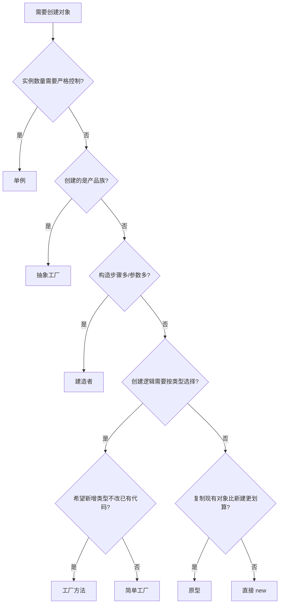

---
tags:
- Java
- SE
- 可信认证
- 设计模式
---

# 创建型设计模式

创建型模式关注**对象如何被创建**。它们把"使用对象"和"实例化对象"解耦，让代码不依赖具体的构造过程，从而更容易替换、配置和测试。

GoF 的创建型模式共 5 种：

| 模式 | 一句话意图 | 典型场景 |
| --- | --- | --- |
| [单例 Singleton](#singleton) | 保证一个类只有一个实例，并提供全局访问点 | 配置中心、连接池、日志器 |
| [工厂方法 Factory Method](#factory-method) | 让子类决定实例化哪个类 | 多种支付渠道、文档解析器 |
| [抽象工厂 Abstract Factory](#abstract-factory) | 创建一系列相关对象，而不指定具体类 | 跨平台 UI 组件族 |
| [建造者 Builder](#builder) | 分步构造复杂对象 | 多参数配置对象、HTTP 请求 |
| [原型 Prototype](#prototype) | 通过复制现有对象来创建新对象 | 昂贵初始化对象、对象快照 |

创建型模式共同服务于 [依赖倒置原则](../principles/dependency-inversion.md)：调用方依赖抽象，具体实例由工厂、建造者等机制提供。

---

## 单例（Singleton）

!!! abstract "意图"
    保证一个类仅有一个实例，并提供一个访问它的全局入口。

### 适用场景

- 无状态或全局唯一的服务（配置、日志、指标注册表）；
- 需要控制资源访问（连接池、线程池、缓存）；
- 创建成本高且可复用的对象。

!!! warning "先问一句：真的需要全局唯一吗"
    单例本质上是**全局状态**，会让依赖关系隐形、测试互相污染。多数场景下，用 [依赖注入](../principles/dependency-inversion.md) 管理"一个实例"比用单例模式更好：容器只创建一个对象，但类本身不限制实例数量。

### 实现方式

**枚举单例（最推荐）**：天然线程安全、防止反射重复创建、防止反序列化破坏。

```java
public enum ConfigRegistry {
    INSTANCE;

    private final Map<String, String> values = new ConcurrentHashMap<>();

    public String get(String key) {
        return values.get(key);
    }

    public void put(String key, String value) {
        values.put(key, value);
    }
}

// 使用
ConfigRegistry.INSTANCE.put("timeout", "30s");
```

**静态内部类（懒加载且线程安全）**：

```java
public class ConnectionPool {
    private ConnectionPool() {
        // 初始化连接
    }

    private static class Holder {
        private static final ConnectionPool INSTANCE = new ConnectionPool();
    }

    public static ConnectionPool getInstance() {
        return Holder.INSTANCE;
    }
}
```

**双重检查锁**：必须给实例字段加 `volatile`，否则可能拿到未初始化完成的对象。

```java
public class Metrics {
    private static volatile Metrics instance;

    private Metrics() {}

    public static Metrics getInstance() {
        if (instance == null) {
            synchronized (Metrics.class) {
                if (instance == null) {
                    instance = new Metrics();
                }
            }
        }
        return instance;
    }
}
```

### 权衡

| 优点 | 缺点 |
| --- | --- |
| 控制实例数量，节省资源 | 引入全局状态，隐藏依赖 |
| 提供统一访问点 | 难以并行测试，测试间可能互相污染 |
| 延迟初始化可缩短启动时间 | 多类加载器、序列化、反射都可能破坏唯一性 |

### 易错点

- 用 `public static final` 直接暴露可变单例，等于开放全局可变状态；
- 在单例里存放请求级数据，导致并发问题；
- 用双重检查锁却忘了 `volatile`；
- 把单例当成"什么都往里塞"的工具类。

---

## 工厂方法（Factory Method）

!!! abstract "意图"
    定义一个创建对象的接口，但让子类决定实例化哪一个类；工厂方法把类的实例化推迟到子类。

### 适用场景

- 创建逻辑复杂，或需要根据配置/环境选择实现；
- 不希望调用方知道具体类名；
- 框架需要留出扩展点，让使用者注册自己的实现。

### 简单工厂 vs 工厂方法

**简单工厂**不是 GoF 模式，但最常见：一个方法根据参数返回不同实现。

```java
public interface Payment {
    void pay(BigDecimal amount);
}

public class AlipayPayment implements Payment {
    @Override public void pay(BigDecimal amount) { /* 支付宝 */ }
}

public class WechatPayment implements Payment {
    @Override public void pay(BigDecimal amount) { /* 微信 */ }
}

public class PaymentFactory {
    public static Payment create(String type) {
        return switch (type) {
            case "alipay" -> new AlipayPayment();
            case "wechat" -> new WechatPayment();
            default -> throw new IllegalArgumentException("不支持的支付方式: " + type);
        };
    }
}
```

简单工厂的问题在 [开闭原则](../principles/open-closed.md)：新增支付方式仍要修改 `switch`。**工厂方法**把选择下放到子类：

```java
public abstract class PaymentCreator {
    public abstract Payment createPayment();

    public void checkout(BigDecimal amount) {
        Payment payment = createPayment(); // 依赖抽象
        payment.pay(amount);
    }
}

public class AlipayCreator extends PaymentCreator {
    @Override public Payment createPayment() { return new AlipayPayment(); }
}

public class WechatCreator extends PaymentCreator {
    @Override public Payment createPayment() { return new WechatPayment(); }
}

// 使用
PaymentCreator creator = new AlipayCreator();
creator.checkout(new BigDecimal("99.00"));
```

新增渠道时只需新增 `Creator` 和 `Payment` 实现，`checkout` 流程不变。

### 权衡

| 优点 | 缺点 |
| --- | --- |
| 解耦调用方与具体类 | 每新增产品通常要新增一个 Creator 类 |
| 符合开闭原则，便于扩展 | 类数量增加，结构变复杂 |
| 创建逻辑集中，便于复用 | 简单场景下显得过度设计 |

### 易错点

- 工厂方法返回具体类型而不是接口，调用方仍然耦合；
- 工厂里堆满业务逻辑，变成"上帝工厂"；
- 用字符串类型选择实现且没有兜底，拼写错误到运行时才暴露。枚举或 `sealed` 类型更安全。

---

## 抽象工厂（Abstract Factory）

!!! abstract "意图"
    提供一个接口，用于创建**一系列相关或相互依赖的对象**，而无需指定它们的具体类。

### 适用场景

- 系统需要多个"产品族"，且同一族的产品必须配套使用；
- 需要在不修改客户端的情况下切换整套实现；
- 典型例子：跨平台 UI（Windows/macOS 风格的按钮 + 复选框）、不同数据库的 DAO 套件。

### 结构

```java
// 产品族：按钮 + 复选框
public interface Button { void render(); }
public interface Checkbox { void render(); }

// 具体产品
public class WindowsButton implements Button {
    @Override public void render() { System.out.println("Windows 按钮"); }
}
public class WindowsCheckbox implements Checkbox {
    @Override public void render() { System.out.println("Windows 复选框"); }
}
public class MacButton implements Button {
    @Override public void render() { System.out.println("macOS 按钮"); }
}
public class MacCheckbox implements Checkbox {
    @Override public void render() { System.out.println("macOS 复选框"); }
}

// 抽象工厂
public interface GuiFactory {
    Button createButton();
    Checkbox createCheckbox();
}

public class WindowsFactory implements GuiFactory {
    @Override public Button createButton() { return new WindowsButton(); }
    @Override public Checkbox createCheckbox() { return new WindowsCheckbox(); }
}

public class MacFactory implements GuiFactory {
    @Override public Button createButton() { return new MacButton(); }
    @Override public Checkbox createCheckbox() { return new MacCheckbox(); }
}

// 客户端只依赖抽象
public class Application {
    private final Button button;
    private final Checkbox checkbox;

    public Application(GuiFactory factory) {
        this.button = factory.createButton();
        this.checkbox = factory.createCheckbox();
    }

    public void render() {
        button.render();
        checkbox.render();
    }
}

// 切换整套外观
Application app = new Application(new MacFactory());
app.render();
```

### 与工厂方法的区别

| | 工厂方法 | 抽象工厂 |
| --- | --- | --- |
| 创建对象 | 一个产品 | 一族产品 |
| 扩展方式 | 新增子类 | 新增工厂实现 |
| 关注点 | 单个产品的实例化延迟 | 产品之间的配套一致性 |
| 复杂度 | 较低 | 较高 |

抽象工厂通常用**工厂方法**来实现每个产品的创建。

### 权衡

- 优点：保证产品族一致；切换实现只需换一个工厂；客户端与具体类解耦。
- 缺点：新增**产品种类**（比如再加一个 `Slider`）需要修改所有工厂接口和实现，违反开闭原则；只有新增**产品族**才容易扩展。

### 易错点

- 产品族并不需要配套，却硬套抽象工厂，导致接口臃肿；
- 把抽象工厂当成"创建一切对象"的入口，最终变成难以维护的超级工厂。

---

## 建造者（Builder）

!!! abstract "意图"
    将一个复杂对象的**构造过程**与它的**表示**分离，使同样的构造过程可以创建不同的表示。

### 适用场景

- 构造函数参数多，尤其是存在大量可选参数；
- 需要分步、按顺序构造对象；
- 需要构造不可变对象；
- 同一构造流程要产出不同形式的结果（如不同格式的报告）。

!!! tip "telescoping constructor 问题"
    ```java
    // 参数一多就失控，调用方要靠位置猜含义
    new Pizza(12, true, false, true, false, "thin", "mozzarella");
    ```
    Builder 用命名方法解决了这个问题。

### 实现

```java
public final class HttpRequest {
    private final String url;
    private final String method;
    private final Map<String, String> headers;
    private final String body;
    private final Duration timeout;

    private HttpRequest(Builder builder) {
        this.url = builder.url;
        this.method = builder.method;
        this.headers = Map.copyOf(builder.headers);
        this.body = builder.body;
        this.timeout = builder.timeout;
    }

    public static Builder builder(String url) {
        return new Builder(url);
    }

    public static final class Builder {
        private final String url;
        private String method = "GET";
        private final Map<String, String> headers = new HashMap<>();
        private String body;
        private Duration timeout = Duration.ofSeconds(10);

        private Builder(String url) {
            this.url = Objects.requireNonNull(url, "url 不能为空");
        }

        public Builder method(String method) { this.method = method; return this; }

        public Builder header(String name, String value) {
            headers.put(name, value);
            return this;
        }

        public Builder body(String body) { this.body = body; return this; }

        public Builder timeout(Duration timeout) {
            this.timeout = timeout;
            return this;
        }

        public HttpRequest build() {
            if (!Set.of("GET", "POST", "PUT", "DELETE").contains(method)) {
                throw new IllegalStateException("不支持的 HTTP 方法: " + method);
            }
            return new HttpRequest(this);
        }
    }
}

// 使用
HttpRequest request = HttpRequest.builder("https://api.example.com/users")
        .method("POST")
        .header("Content-Type", "application/json")
        .body("{\"name\":\"Alice\"}")
        .timeout(Duration.ofSeconds(5))
        .build();
```

要点：

- 外部类不可变，字段 `final`；
- Builder 的构造器校验必填参数，`build()` 做跨字段校验；
- 集合在 `build()` 时做防御性拷贝；
- 链式方法返回 `this`，便于串联。

### 与工厂的区别

- 工厂关注**创建什么**（选择产品类型）；
- 建造者关注**怎么一步步创建**（组装复杂对象）。
- 建造者通常返回一个具体产品，工厂通常返回接口。

### 易错点

- 省略 `build()` 校验，把非法状态的对象交给调用方；
- Builder 和产品共享可变集合，导致构造后仍被修改；
- 为只有两三个参数的简单类也写 Builder，增加无谓样板代码。

---

## 原型（Prototype）

!!! abstract "意图"
    用克隆现有实例的方式创建新对象，而不是重新走一遍构造流程。

### 适用场景

- 对象初始化成本高（加载大文件、复杂计算），但副本只需少量修改；
- 需要保存/恢复对象状态（与 [备忘录模式](behavioral.md#memento) 相关）；
- 避免为每种配置都写一个子类。

### 浅拷贝与深拷贝

```java
public class Document implements Cloneable {
    private String title;
    private List<String> paragraphs;

    public Document(String title, List<String> paragraphs) {
        this.title = title;
        this.paragraphs = new ArrayList<>(paragraphs);
    }

    // 浅拷贝：paragraphs 仍指向同一个列表
    @Override
    public Document clone() {
        try {
            return (Document) super.clone();
        } catch (CloneNotSupportedException e) {
            throw new AssertionError(e);
        }
    }

    // 推荐：拷贝构造器，语义清晰，也能处理 final 字段
    public Document copy() {
        return new Document(title, new ArrayList<>(paragraphs));
    }
}
```

!!! warning "`Cloneable` 的坑"
    - `Cloneable` 是一个标记接口，不包含 `clone()` 方法；
    - `Object.clone()` 是浅拷贝，引用类型字段会被共享；
    - `clone()` 绕过构造器，可能破坏不变式；
    - 推荐使用**拷贝构造器**或静态工厂 `copyOf()`，除非确实需要性能极致的复制。

深拷贝示例：

```java
public Document deepCopy() {
    List<String> copied = paragraphs.stream()
            .map(String::new)
            .collect(Collectors.toCollection(ArrayList::new));
    return new Document(new String(title), copied);
}
```

### 原型注册表

当需要按名称创建预设对象时，可以维护一个原型缓存：

```java
public class ShapeRegistry {
    private final Map<String, Shape> prototypes = new HashMap<>();

    public void register(String key, Shape prototype) {
        prototypes.put(key, prototype);
    }

    public Shape create(String key) {
        Shape prototype = prototypes.get(key);
        if (prototype == null) {
            throw new IllegalArgumentException("未注册的原型: " + key);
        }
        return prototype.copy();
    }
}
```

### 易错点

- 该深拷贝却用了浅拷贝，导致两个对象共享可变状态；
- 原型对象本身被修改后，后续克隆全部被污染；
- 用 `clone()` 复制带资源（文件句柄、连接）的对象，导致资源被重复释放。

---

## 如何选择



!!! tip "最后一条建议"
    模式是手段，不是目的。如果 `new` 一个对象足够清晰，就 `new`。引入工厂、建造者的理由应当是**创建逻辑复杂、需要替换、或需要隐藏细节**，而不是"设计模式看起来更专业"。
