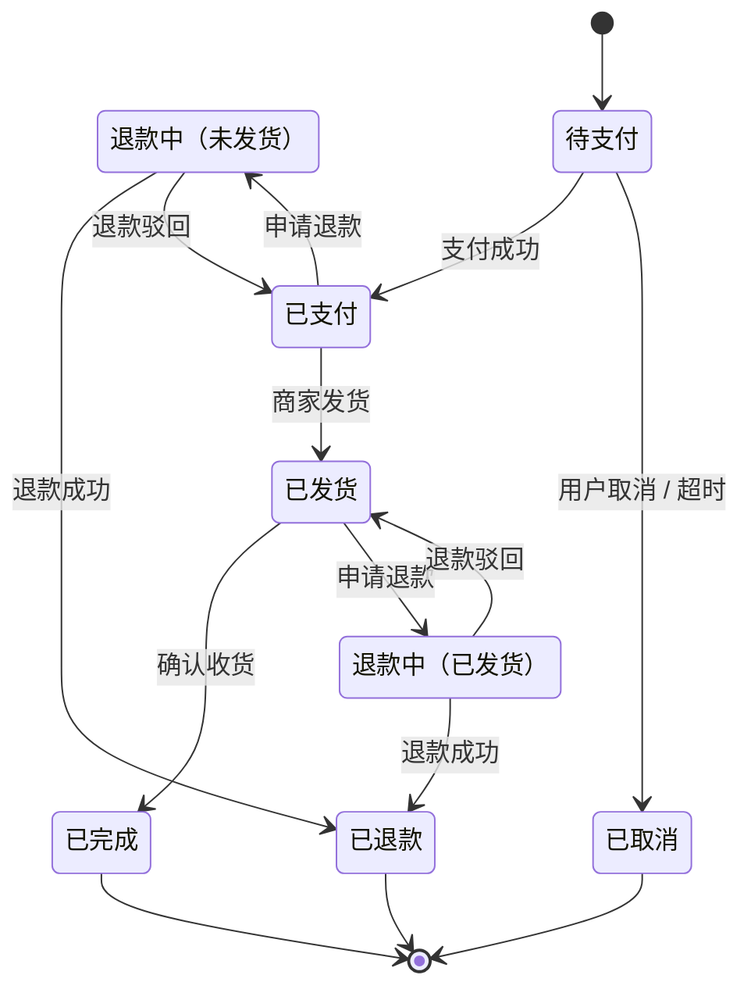

---
tags:
- Java
- SE
- 软件测试
---

# 黑盒测试

!!! abstract "一句话"
    把被测对象看作一个黑盒：不关心内部怎么实现，只根据需求、规格和可观察的输入输出设计测试。

黑盒测试（Black-box Testing）又称功能测试、行为测试。测试人员只关心**输入什么、执行什么操作、应该看到什么结果**，不依赖代码结构。因此它既可以在代码完成后执行，也可以在需求或原型阶段提前设计用例。

| 优点 | 局限 |
| --- | --- |
| 站在用户和需求视角，容易发现功能缺失和理解偏差 | 无法知道哪些代码路径没有被执行 |
| 用例与实现解耦，重构后仍可复用 | 需求描述不清时，预期结果难以确定 |
| 适合系统测试、验收测试和第三方测试 | 大量输入可能重复覆盖同一段内部逻辑 |
| 不要求测试人员了解实现细节 | 难以直接定位缺陷所在的代码 |

黑盒测试不是"随便点一点"。要系统地选择输入，需要下面的用例设计方法。

## 等价类划分

等价类划分（Equivalence Partitioning）把输入域分成若干类：**同一类中的任意一个值，程序的处理逻辑和输出应当相同**。于是每个类只需要选一个代表值，就能以较少的用例覆盖较大的输入空间。

等价类分为两种：

- **有效等价类**：符合需求、应当被正常处理的输入；
- **无效等价类**：不符合需求、应当被拒绝或给出错误提示的输入。

### 设计步骤

1. 分析需求，列出每个输入条件及其取值范围；
2. 为每个输入条件划分有效等价类和无效等价类，并编号；
3. 为每个等价类各设计一条用例；
4. 有效等价类可以尽量组合到同一条用例中；**无效等价类通常一次只覆盖一个**，其余输入保持有效。

最后一条很重要：如果一条用例同时放了多个非法输入，程序可能因为第一个错误就返回，后面的非法输入根本没有被检查到，缺陷会被"屏蔽"。

### 示例：注册年龄

需求：用户年龄必须是 **18 到 60 之间的整数（含 18 和 60）**。

| 输入条件 | 有效等价类 | 无效等价类 |
| --- | --- | --- |
| 年龄 | V1：`18 ≤ age ≤ 60` 的整数 | I1：`age < 18` |
| | | I2：`age > 60` |
| | | I3：非整数，如 `20.5`、`abc` |
| | | I4：空值或缺失 |

据此可以设计用例：

| 编号 | 输入 | 预期结果 | 覆盖的等价类 |
| --- | --- | --- | --- |
| TC1 | `age = 25` | 注册成功 | V1 |
| TC2 | `age = 17` | 提示年龄不能小于 18 | I1 |
| TC3 | `age = 61` | 提示年龄不能大于 60 | I2 |
| TC4 | `age = 20.5` | 提示必须输入整数 | I3 |
| TC5 | `age` 为空 | 提示年龄必填 | I4 |

等价类划分只回答了"选哪些值"，还没有回答"选在区间的哪个位置"。边界值分析正好补上这一点。

## 边界值分析

大量缺陷发生在输入范围的边缘：循环的第一次和最后一次、数组的首尾、金额刚好达到阈值、日期跨月跨年。边界值分析（Boundary Value Analysis）专门选取**边界及其邻近值**。

对于闭区间 `[18, 60]`，常用"三点法"取：

| 位置 | 取值 | 说明 |
| --- | --- | --- |
| 下界外点 | 17 | 刚好无效 |
| 下界上点 | 18 | 刚好有效 |
| 下界内点 | 19 | 有效 |
| 上界内点 | 59 | 有效 |
| 上界上点 | 60 | 刚好有效 |
| 上界外点 | 61 | 刚好无效 |

如果只关心边界本身，可以用"两点法"，只取 18、60 以及紧邻的 17、61。对离散的整数域，`min-1`、`min`、`max`、`max+1` 通常都要覆盖；对连续值或浮点数，则选择"最接近边界且可表示"的值，并注意精度误差。

边界值分析常与等价类划分一起使用：**先划分等价类，再在每个类的边界上取值**。

更多边界场景：

- 字符串长度为 0、1、最大长度、最大长度 + 1；
- 集合/数组为空、只有一个元素、刚好达到容量；
- 金额为 0、0.01、阈值、阈值 + 0.01；
- 日期为闰年 2 月 29 日、月末、年末；
- 分页的页码为 1、最后一页、最后一页 + 1。

## 决策表

当输出由**多个条件的组合**决定时，条件之间可能存在 `与`、`或`、互斥等关系。决策表（Decision Table）把所有条件组合和对应动作列成表格，能有效发现遗漏的规则和规则冲突。

决策表通常包含四部分：

| 条件桩 | 条件项 |
| --- | --- |
| 动作桩 | 动作项 |

每一列是一条规则（rule），表示一种条件组合下应执行的动作。

### 示例：订单折扣

规则如下：

- 会员且订单满 200 元：8 折；
- 会员但未满 200 元：9 折；
- 非会员且满 200 元：有券 9 折，无券 95 折；
- 非会员且未满 200 元：有券 95 折，无券原价。

| 条件 / 动作 | R1 | R2 | R3 | R4 | R5 | R6 | R7 | R8 |
| --- | --- | --- | --- | --- | --- | --- | --- | --- |
| 是会员 | Y | Y | Y | Y | N | N | N | N |
| 订单满 200 | Y | Y | N | N | Y | Y | N | N |
| 使用优惠券 | Y | N | Y | N | Y | N | Y | N |
| 8 折 | ✓ | ✓ | | | | | | |
| 9 折 | | | ✓ | ✓ | ✓ | | | |
| 95 折 | | | | | | ✓ | ✓ | |
| 原价 | | | | | | | | ✓ |

观察 R1/R2 和 R3/R4：当"是会员"时，优惠券不影响结果，这两组规则可以合并，用 `—` 表示无关条件：

| 条件 / 动作 | R1 | R2 | R3 | R4 | R5 | R6 |
| --- | --- | --- | --- | --- | --- | --- |
| 是会员 | Y | Y | N | N | N | N |
| 订单满 200 | Y | N | Y | Y | N | N |
| 使用优惠券 | — | — | Y | N | Y | N |
| 8 折 | ✓ | | | | | |
| 9 折 | | ✓ | ✓ | | | |
| 95 折 | | | | ✓ | ✓ | |
| 原价 | | | | | | ✓ |

合并后的 6 条规则各设计一条用例即可。决策表的价值在于：**规则数量一目了然，`—` 和空缺会提醒我们哪里可能漏了规则，同一组合对应多个动作则提示规则冲突。**

## 状态转换测试

有些系统的输出不只取决于当前输入，还取决于**当前处于什么状态**。例如订单、支付、审批、登录锁定。状态转换测试（State Transition Testing）把系统建模为状态机：

- **状态**：系统在某一时刻的稳定情况；
- **事件**：触发状态变化的外部输入；
- **转换**：从一个状态到另一个状态，可带守卫条件（guard）和动作；
- **非法转换**：当前状态不应接受的事件。

### 示例：订单状态

对应的转换表：

| 当前状态 | 事件 | 下一状态 | 说明 |
| --- | --- | --- | --- |
| 待支付 | 支付成功 | 已支付 | 正常支付 |
| 待支付 | 用户取消 / 超时 | 已取消 | 终态 |
| 已支付 | 商家发货 | 已发货 | |
| 已支付 | 申请退款 | 退款中（未发货） | 未发货可退款 |
| 已发货 | 确认收货 | 已完成 | 终态 |
| 已发货 | 申请退款 | 退款中（已发货） | |
| 退款中（未发货） | 退款成功 | 已退款 | 终态 |
| 退款中（未发货） | 退款驳回 | 已支付 | 回到支付状态 |
| 退款中（已发货） | 退款成功 | 已退款 | 终态 |
| 退款中（已发货） | 退款驳回 | 已发货 | 回到发货状态 |

常见的覆盖要求由弱到强：

| 覆盖准则 | 要求 |
| --- | --- |
| 状态覆盖 | 每个状态至少到达一次 |
| 转换覆盖（0-switch） | 每条合法转换至少执行一次 |
| N-switch 覆盖 | 连续 N+1 条转换组成的路径至少执行一次 |
| 非法转换覆盖 | 每个非法事件都被拒绝，且状态不变 |

例如一条正常路径 `待支付 → 已支付 → 已发货 → 已完成` 可以覆盖多条转换；而"退款驳回后再次申请退款"需要专门设计，否则 `退款中（已发货）→ 已发货` 这条回边很容易被遗漏。

## 其他常用方法

### 因果图

因果图（Cause-Effect Graphing）先把需求中的原因（输入条件）和结果（输出动作）画成图，再标注约束（互斥、包含、唯一等），最后转换成决策表。它适合条件组合多、条件之间有约束的场景，本质上仍是把组合关系系统化。

### 正交实验与成对组合

当有多个配置项、每个配置项有多个取值时，全组合数量会爆炸。例如 4 个参数各有 3 个取值，全组合是 `3^4 = 81` 条。成对（pairwise）组合只要求**任意两个参数的取值组合至少出现一次**，通常十几条用例就能覆盖大部分由参数交互引起的缺陷。

### 场景法

场景法从用例的基本流和备选流出发：

- **基本流**：一切顺利的主路径；
- **备选流**：某一步出现异常或选择了其他分支。

把基本流和各备选流组合成场景，覆盖"正常完成、中途取消、失败重试、并发操作"等真实使用方式。它和状态转换测试经常配合使用。

## 方法如何配合

实际项目中，测试方法通常组合使用：

| 测试依据 | 优先方法 |
| --- | --- |
| 单个字段的取值要求 | 等价类划分 + 边界值分析 |
| 多条业务规则的组合 | 决策表 + 因果图 |
| 有状态、有先后顺序的业务 | 状态转换测试 + 场景法 |
| 多配置项、多环境参数 | 成对组合 / 正交实验 |
| 端到端用户流程 | 场景法 |

先用系统方法保证"该覆盖的规则都覆盖"，再用基于经验的方法补充历史缺陷和特殊场景，参见[基于经验的测试](experience.md)。

## 黑盒测试的局限

黑盒测试无法直接回答下面这些问题：

- 某段代码是否从未被执行？是否存在死代码？
- 某个 `if` 的另一条分支是否可达？
- 异常处理、资源释放、并发控制是否真的被执行？
- 输入组合已经很多，哪些组合对应同一条内部路径，哪些组合被遗漏？

这些问题需要打开盒子，借助[白盒测试](whitebox.md)从代码结构角度补充。反过来，白盒测试也不能证明需求被正确实现，两者不是替代关系。

??? question "无效等价类为什么要一次只覆盖一个？"
    如果一条用例同时包含多个非法输入，程序可能在检查到第一个错误时就返回，后面的非法输入根本没有被验证。分开设计可以让每条用例的失败原因唯一，便于定位缺陷；也能避免一个缺陷掩盖另一个缺陷。

??? question "边界值分析一定要取 min-1 和 max+1 吗？"
    不一定。对离散整数域，`min-1` / `max+1` 是紧邻边界的有效测试点；对连续值、浮点数或取值范围极大的域，应取"最接近边界且可表示"的值，并考虑精度。关键是测试**边界两侧的行为**，而不是机械地加减一。

??? question "决策表规则很多时怎么办？"
    先检查是否存在无关条件（用 `—` 合并）、互斥条件和不可能组合，通常能大幅压缩规则数。压缩后仍很大时，再考虑成对组合或在风险高的规则上优先设计用例，而不是盲目追求全组合。

## 小结

- 黑盒测试依据需求和外部行为，不依赖代码结构；
- 等价类划分解决"选哪些值"，边界值分析解决"选在值域的什么位置"；
- 决策表处理多条件组合，状态转换处理有先后顺序的业务；
- 成对组合和场景法用于控制组合爆炸、贴近真实使用流程；
- 黑盒测试擅长验证"做什么"，但无法判断"哪些代码没被执行"，需要白盒测试互补。
