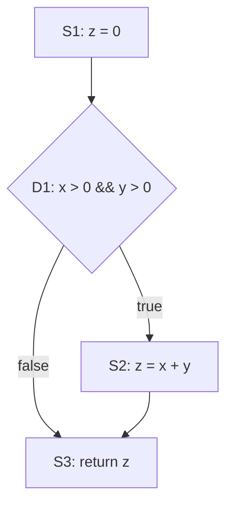

---
tags:
- Java
- SE
- 软件测试
include:
- math
---

# 白盒测试

!!! abstract "一句话"
    打开盒子看代码：依据程序内部的控制结构设计用例，让语句、分支、条件和路径尽可能被执行到。

白盒测试（White-box Testing）又称结构测试、玻璃盒测试。它基于**代码内部结构**而不是需求文档来选择测试数据，常见于单元测试和代码级质量检查。白盒测试关心的是：

- 哪些语句被执行了？
- 每个判断的真假分支是否都走到了？
- 复合条件中的每个原子条件是否都取过真和假？
- 从入口到出口的路径是否都覆盖了？
- 变量的定义和使用之间是否存在异常？

覆盖率是白盒测试最常用的度量，但覆盖率只是"执行到了"，不等于"验证正确了"。

## 控制流图

控制流图（Control Flow Graph，CFG）把程序抽象成节点和边：

- **节点**：一条语句或一个基本块（顺序执行、只有一个入口和一个出口的语句序列）；
- **边**：控制流可能从一个节点转移到另一个节点；
- **判定节点**：有多个后继的节点，如 `if`、`while`、`switch`。

以后面的示例代码为例：

```java
public class Calculator {
    public static int f(int x, int y) {
        int z = 0;                  // S1
        if (x > 0 && y > 0) {       // D1: c1 = x > 0, c2 = y > 0
            z = x + y;              // S2
        }
        return z;                   // S3
    }
}
```

对应的控制流图：



图中 `D1` 是判定节点，`S2` 是 `D1` 为真时才执行的语句。白盒覆盖准则就是对这个图提出不同的"走遍"要求。

## 圈复杂度

圈复杂度（Cyclomatic Complexity，McCabe）衡量控制流的复杂程度，也对应**一组线性独立路径的数量**（即覆盖所有边所需的最少路径数）：

$$
V(G) = E - N + 2
$$

其中 `E` 是边数，`N` 是节点数。也可以用更简单的形式：

$$
V(G) = P + 1
$$

`P` 是判定节点的数量。对上面的控制流图：

- 节点 `N = 4`，边 `E = 4`，所以 `V(G) = 4 - 4 + 2 = 2`；
- 判定节点只有 `D1`，所以 `V(G) = 1 + 1 = 2`。

圈复杂度的常见解读：

| 复杂度 | 含义 |
| --- | --- |
| 1 – 10 | 结构简单，测试和维护成本较低 |
| 11 – 20 | 较复杂，需要更完整的测试 |
| 21 – 50 | 复杂，建议重构 |
| > 50 | 极难测试和维护，风险很高 |

这些阈值只是经验值。圈复杂度高意味着独立路径多、理解成本高、遗漏组合的风险大，但它不是覆盖准则本身：达到某个复杂度并不代表测试充分。

## 覆盖准则

仍以上面的 `f(x, y)` 为例。四个输入对应的条件与判定结果：

| 用例 | x | y | c1: x > 0 | c2: y > 0 | D1 | 结果 z |
| --- | --- | --- | --- | --- | --- | --- |
| T1 | 1 | 1 | T | T | T | 2 |
| T2 | 1 | -1 | T | F | F | 0 |
| T3 | -1 | 1 | F | T | F | 0 |
| T4 | -1 | -1 | F | F | F | 0 |

### 语句覆盖（Statement Coverage，SC）

要求：**每条可执行语句至少执行一次**。

`{T1}` 就能覆盖 `S1`、`S2`、`S3` 和判定 `D1`，语句覆盖率达到 100%。

但语句覆盖非常弱：它不要求 `D1` 为假的分支被执行，也不检查条件组合。如果把代码中的 `&&` 误写成 `||`，`{T1}` 依然会通过。

### 判定覆盖（Decision/Branch Coverage，DC）

要求：**每个判定的真分支和假分支至少各执行一次**。

`{T1, T2}` 中 `D1` 先为真、后为假，满足判定覆盖；同时语句覆盖也自然满足。

判定覆盖也常被称为分支覆盖。它比语句覆盖强，但仍然不关心复合条件内部的情况：`{T1, T2}` 只出现了 `TT` 和 `TF`，没有验证 `c1` 为假时会发生什么。

### 条件覆盖（Condition Coverage，CC）

要求：**每个原子条件的真、假取值至少各出现一次**。

`{T2, T3}` 中：

- `c1`：T2 为 T，T3 为 F；
- `c2`：T2 为 F，T3 为 T。

两个条件都取过真和假，满足条件覆盖。但这两条用例的 `D1` 全为假，**真分支一次都没走到**。这说明：

> 条件覆盖不必然包含判定覆盖。满足了每个原子条件，仍可能漏掉整个判定的一种结果。

### 判定-条件覆盖（Decision/Condition Coverage，CDC）

要求：**同时满足判定覆盖和条件覆盖**——每个判定结果至少一次，每个原子条件的真假也至少一次。

`{T1, T4}` 可以满足：

- `D1`：T1 为 T，T4 为 F；
- `c1`：T1 为 T，T4 为 F；
- `c2`：T1 为 T，T4 为 F。

（`{T1, T2, T3}` 也可以，但本例用两条用例就够了。）CDC 弥补了条件覆盖可能漏掉分支的问题。

### 条件组合覆盖（Multiple Condition Coverage，MCC）

要求：**每个判定中所有原子条件的真值组合至少各出现一次**。

`D1` 有两个条件，共 `2^2 = 4` 种组合，因此需要 `{T1, T2, T3, T4}`：

| 组合 | 用例 |
| --- | --- |
| `c1 = T, c2 = T` | T1 |
| `c1 = T, c2 = F` | T2 |
| `c1 = F, c2 = T` | T3 |
| `c1 = F, c2 = F` | T4 |

MCC 比 CDC 更强，能发现某些只在特定条件组合下才出现的错误。但当判定很多、条件很多时，组合数会快速膨胀，通常需要结合业务风险做取舍。

### 路径覆盖（Path Coverage，PC）

要求：**从入口到出口的每条可行路径至少执行一次**。

本例的控制流图只有两条路径：

- 真路径：`S1 → D1(true) → S2 → S3`，由 T1 覆盖；
- 假路径：`S1 → D1(false) → S3`，由 T2、T3、T4 中任意一条覆盖。

所以 `{T1, T2}` 就满足路径覆盖。

路径覆盖通常强于判定覆盖，但它也不等于"覆盖所有条件组合"：`{T1, T2}` 只出现了 `TT` 和 `TF`，`FT`、`FF` 两种组合没有单独验证。路径覆盖在存在循环时还会遇到路径数量爆炸的问题：一个循环执行 0 次、1 次、2 次……理论上都是不同路径，实际测试只能选取代表性的循环次数。

### 准则对比

| 准则 | 要求 | 本例最少用例 |
| --- | --- | --- |
| 语句覆盖 SC | 每条可执行语句至少一次 | `{T1}` |
| 判定覆盖 DC | 每个判定的真、假分支至少一次 | `{T1, T2}` |
| 条件覆盖 CC | 每个原子条件的真、假至少一次 | `{T2, T3}` |
| 判定-条件覆盖 CDC | 同时满足 DC 和 CC | `{T1, T4}` |
| 条件组合覆盖 MCC | 每个判定的全部条件组合至少一次 | `{T1, T2, T3, T4}` |
| 路径覆盖 PC | 每条可行路径至少一次 | `{T1, T2}` |

它们之间的大致关系：

- 判定覆盖通常强于语句覆盖；
- 条件覆盖与判定覆盖是**不同维度**，条件覆盖不必然包含判定覆盖；
- 判定-条件覆盖同时满足判定覆盖和条件覆盖；
- 条件组合覆盖强于判定-条件覆盖；
- 路径覆盖关注完整执行路径，通常强于判定覆盖，但不必然覆盖所有条件组合。

## 用 JUnit 编写白盒测试

上面的用例可以直接写成 JUnit 5 测试：

```java
import org.junit.jupiter.api.Test;
import static org.junit.jupiter.api.Assertions.assertEquals;

class CalculatorTest {

    @Test
    void shouldSumWhenBothPositive() {
        // T1：D1 为真，覆盖 S2
        assertEquals(2, Calculator.f(1, 1));
    }

    @Test
    void shouldReturnZeroWhenEitherNonPositive() {
        // T2、T3、T4：D1 为假
        assertEquals(0, Calculator.f(1, -1));
        assertEquals(0, Calculator.f(-1, 1));
        assertEquals(0, Calculator.f(-1, -1));
    }
}
```

参数化测试可以让用例表更清晰：

```java
import org.junit.jupiter.params.ParameterizedTest;
import org.junit.jupiter.params.provider.CsvSource;
import static org.junit.jupiter.api.Assertions.assertEquals;

class CalculatorParameterizedTest {

    @ParameterizedTest(name = "f({0}, {1}) = {2}")
    @CsvSource({
            "1,  1, 2",
            "1, -1, 0",
            "-1, 1, 0",
            "-1,-1, 0"
    })
    void testF(int x, int y, int expected) {
        assertEquals(expected, Calculator.f(x, y));
    }
}
```

写测试时还要注意：**每个用例都必须有有效的断言**。只调用方法不断言，覆盖率可能很高，但缺陷仍然会漏过。

## 数据流测试

控制流覆盖关注"走了哪些边"，数据流测试关注"变量的定义和使用是否被合理连接"：

- **定义（def）**：变量被赋值；
- **使用（use）**：变量被读取，又分为计算使用（c-use）和判定使用（p-use）；
- **定义-使用链（du-chain）**：从一次定义到一次使用之间的路径。

常见准则：

| 准则 | 要求 |
| --- | --- |
| All-Defs | 每个变量的每次定义至少到达一次使用 |
| All-Uses | 每条定义-使用链至少执行一次 |
| All-DU-Paths | 每条定义-使用链上的所有路径至少执行一次 |

数据流测试可以帮助发现"变量未初始化就被使用""赋值后从未被读取""异常路径上状态没有更新"等问题，这些是单纯看语句或分支容易忽略的。

## 白盒测试的两种形态

白盒测试不一定都要运行程序：

| 形态 | 做法 | 例子 |
| --- | --- | --- |
| 静态白盒测试 | 不执行代码，直接分析源程序 | 代码审查、静态分析、数据流分析 |
| 动态白盒测试 | 运行程序并收集覆盖信息 | 单元测试、覆盖率统计、变异测试 |

### 代码审查

代码审查（Code Review）是最经济的静态测试。常看的风险点：

- 空值、空集合、空字符串是否处理；
- 边界条件、循环的起止、`<=` 与 `<`；
- 异常是否被吞掉，资源是否在 `finally` / try-with-resources 中释放；
- 并发访问是否有竞态，集合是否线程安全；
- 敏感信息是否写入日志，输入是否校验；
- 重复代码、过长方法、过深嵌套；
- 需求中的规则是否都有对应实现。

### 静态分析工具

- **SpotBugs**：字节码层面的缺陷模式检查；
- **PMD**：源代码规则检查，如未使用变量、空 `catch`；
- **Checkstyle**：编码规范；
- **SonarQube**：综合质量平台，汇总缺陷、坏味道和覆盖率。

静态分析擅长发现模式化问题，但会有误报，也可能漏掉业务逻辑错误，不能替代动态测试和人工审查。

## 覆盖率工具与变异测试

Java 项目常用的覆盖率工具是 **JaCoCo**，可以统计行覆盖、分支覆盖、方法覆盖和类覆盖，并生成 HTML 报告。IDE 也内置了覆盖率运行功能。

覆盖率工具回答的是"执行到了多少"，而不是"断言能否发现问题"。**变异测试**（Mutation Testing，Java 常用 PIT）通过自动修改代码（例如把 `>` 改成 `>=`、把 `+` 改成 `-`），检查测试是否能"杀死"这些变异体：

- 测试失败 → 变异体被杀死，说明测试能发现这个变化；
- 测试仍然通过 → 变异体存活，说明测试的断言不够强或该代码没有被有效验证。

因此，变异测试常被用来评估**测试本身的质量**，弥补单看覆盖率数字的不足。

## 白盒与黑盒的互补

| 维度 | 黑盒测试 | 白盒测试 |
| --- | --- | --- |
| 依据 | 需求、规格、外部行为 | 代码结构、控制流、数据流 |
| 视角 | 用户 / 业务 | 开发者 / 实现 |
| 擅长 | 功能是否正确、需求是否满足 | 代码是否被执行、分支和条件是否覆盖 |
| 局限 | 不知道哪些代码没被执行 | 不知道需求是否被正确理解 |
| 典型层次 | 系统测试、验收测试 | 单元测试、集成测试 |
| 典型方法 | 等价类、边界值、决策表、状态转换 | 语句/判定/条件/路径覆盖、数据流分析 |

实际测试通常是"黑盒设计业务场景，白盒检查实现细节"：先用需求和风险确定要验证什么，再用覆盖率找出遗漏的代码路径，最后补充针对性的用例。

??? question "覆盖率达到 100% 就没有缺陷了吗？"
    不是。覆盖率只说明代码被执行过，不能说明：

    - 断言是否正确、是否足够强；
    - 需求本身是否完整、是否被正确理解；
    - 数据相关的缺陷（不同数据分布、精度、编码）是否被触发；
    - 并发、时序、网络、数据库等环境相关问题是否被覆盖；
    - 不可达代码、死代码是否被误认为"已测试"。

    即使行覆盖 100%，分支、条件组合和路径仍可能没有覆盖完整；即使所有覆盖准则都满足，测试也可能因为缺少断言而漏掉错误。覆盖率是发现遗漏的工具，不是质量结论。

??? question "条件覆盖和判定覆盖到底有什么区别？"
    判定覆盖看的是**整个判定的结果**：`if (x > 0 && y > 0)` 这个判定为真和为假各至少一次。条件覆盖看的是**每个原子条件**：`x > 0` 和 `y > 0` 各自取过真和假。

    两者不能互相保证。比如 `{x=1,y=-1}` 与 `{x=-1,y=1}`：两个原子条件都取过真和假，但判定始终为假，漏掉了真分支。反过来，只让整个判定真一次、假一次，也不一定让每个原子条件都取过两种值。

??? question "圈复杂度高就一定说明代码有问题吗？"
    不一定。圈复杂度高说明独立路径多、测试和维护成本高，是一个风险信号，但简单直接的业务规则、自动生成的代码也可能有较高复杂度。更重要的是看复杂度集中在哪个方法、是否伴随重复逻辑和深层嵌套，以及高风险路径是否有对应的测试。

## 小结

- 白盒测试依据代码结构，控制流图是分析的基础；
- 语句覆盖最弱，判定覆盖关注分支，条件覆盖关注原子条件，条件组合覆盖关注组合，路径覆盖关注完整路径；
- 条件覆盖不必然包含判定覆盖，判定-条件覆盖同时满足两者；
- 覆盖率达到 100% 不保证没有缺陷，断言质量、需求理解和环境因素同样重要；
- 静态审查、静态分析、数据流分析和变异测试都是白盒质量手段；
- 白盒测试与黑盒测试互补，实际项目应结合使用。
