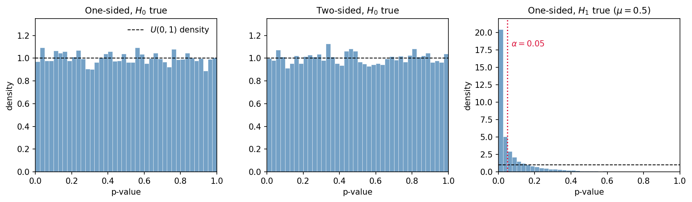

---
tags:
- 概率论
include:
- math
---

# P值

p值（p-value）大概是统计学里被引用最多、也被误解最多的数字之一。它经常被当作“显著性”的同义词，甚至被当成“结论为真的概率”。这一篇从定义出发，看看p值到底是什么、它服从什么分布，以及为什么它会被这么多统计学家批评。

## p值是什么

!!! definition "p值的通俗定义"
    设样本 $X=(X_1,\dots,X_n)$ 来自某个总体，零假设为 $H_0$，备择假设为 $H_1$。选取检验统计量 $T=T(X)$，记它在样本上的观测值为 $t_O$。如果 $T$ 在 $H_0$ 下服从连续分布，那么**p值**定义为
    $$
    p=\mathbb{P}_{H_0}(T\text{至少和}t_O\text{一样极端})
    $$
    其中“极端”的方向由备择假设 $H_1$ 决定。

也就是说，p值回答的是这样一个问题：

> **假如零假设成立，出现当前这么大（或更大）的检验统计量的概率是多少？**

注意条件的箭头方向。p值是
$$
\mathbb{P}(\text{数据至少这么极端}\mid H_0\text{ 成立}),
$$
而不是
$$
\mathbb{P}(H_0\text{ 成立}\mid \text{数据}).
$$
后者是贝叶斯后验概率，需要先验分布；两者通常相差很远。把前者当成后者，是p值最常见的误读。

!!! note "复合零假设"
    如果 $H_0:\theta\in\Theta_0$ 是复合假设，严格来说应取
    $$
    p=\sup_{\theta\in\Theta_0}\mathbb{P}_\theta(T\ge t_{\text{obs}}),
    $$
    这样才能保证在原假设成立时第一类错误率不超过 $\alpha$。本文的正态均值例子中 $H_0:\mu=\mu_0$ 是简单假设；即使写成 $H_0:\mu\le\mu_0$，上确界也在 $\mu=\mu_0$ 处取到，结果相同。

p值是一个**统计量**。检验统计量 $T$ 是样本的函数，样本是随机的，所以 $T$ 是随机变量，$p=p(T)$ 也是随机变量。既然p值是随机变量，它就有自己的分布——这是理解p值的关键，也是下一节的主题。

在频率学派的标准操作里，我们事先给定显著性水平 $\alpha$（通常取 $0.05$），然后规定：

$$
p\le\alpha\quad\Longrightarrow\quad\text{拒绝 }H_0.
$$

$\alpha$ 是犯第一类错误（原假设为真却拒绝它）的概率上限。至于为什么偏偏是 $0.05$，更多是历史约定，而不是数学定理。

!!! warning "p值不是什么"
    - 不是 $H_0$ 为真的概率；
    - 不是数据“由随机因素产生”的概率；
    - 不是效应大小，也不是结果的重要性；
    - 不是“重复实验会得到同样结论”的概率；
    - 不是置信水平，也不是贝叶斯后验概率。

## p值的例子

下面用最经典的正态均值检验来把定义落到具体公式上。设
$$
X_1,\dots,X_n\overset{iid}{\sim}N(\mu,\sigma^2),
$$
其中 $\sigma$ 已知，样本均值为 $\bar X$。

### 单边检验

考虑右单边检验
$$
H_0:\mu=\mu_0\quad\text{vs}\quad H_1:\mu>\mu_0.
$$
取检验统计量
$$
Z=\frac{\sqrt n(\bar X-\mu_0)}{\sigma}.
$$
在 $H_0$ 下 $Z\sim N(0,1)$。观测到 $z_{\text{obs}}$ 后，比它更极端的就是更大的 $Z$，所以
$$
p=\mathbb{P}(Z\ge z_{\text{obs}})=1-\Phi(z_{\text{obs}})=\Phi(-z_{\text{obs}}),
$$
其中 $\Phi$ 是标准正态分布的分布函数。

举个具体例子：$n=16$，$\sigma=1$，$\mu_0=0$，观测到 $\bar x=0.5$。那么
$$
z_{\text{obs}}=\frac{\sqrt{16}\times0.5}{1}=2,
$$
于是
$$
p=1-\Phi(2)\approx0.0228.
$$
如果 $\alpha=0.05$，就拒绝 $H_0$。

如果是左单边检验 $H_1:\mu<\mu_0$，极端方向反过来，p值为
$$
p=\mathbb{P}(Z\le z_{\text{obs}})=\Phi(z_{\text{obs}}).
$$

### 双边检验

考虑
$$
H_0:\mu=\mu_0\quad\text{vs}\quad H_1:\mu\ne\mu_0.
$$
这时“更极端”指的是**偏离得比观测值更远**，不论正负：
$$
p=\mathbb{P}(|Z|\ge|z_{\text{obs}}|)=2(1-\Phi(|z_{\text{obs}}|))=2\Phi(-|z_{\text{obs}}|).
$$
上面的例子中
$$
p=2\Phi(-2)\approx0.0455.
$$

用代码计算：

```python
from scipy import stats

z_obs = 2.0
p_right = stats.norm.sf(z_obs)            # H1: mu > mu0
p_left = stats.norm.cdf(z_obs)            # H1: mu < mu0
p_two = 2 * stats.norm.sf(abs(z_obs))     # H1: mu != mu0

print(f"右单边 p = {p_right:.4f}")
print(f"左单边 p = {p_left:.4f}")
print(f"双边   p = {p_two:.4f}")
```

输出是：

```
右单边 p = 0.0228
左单边 p = 0.9772
双边   p = 0.0455
```

!!! warning "双边p值不总是单边p值的两倍"
    如果数据的方向和单边备择假设相反，单边p值会很大。比如观测到 $z_{\text{obs}}=-2$ 时，右单边检验的p值是 $\Phi(-2)=0.977$，但双边p值仍然是 $0.0455$。

    对连续且对称的检验统计量，正确的关系是
    $$
    p_{\text{双边}}=2\min\{p_{\text{左单边}},p_{\text{右单边}}\}.
    $$
    只有观测方向与单边备择假设一致时，才有“双边 = 2 × 单边”。如果检验统计量的分布不对称，这个关系还要再改。

!!! note "$\sigma$ 未知怎么办"
    把 $\sigma$ 换成样本标准差 $s$，统计量变成
    $$
    T=\frac{\sqrt n(\bar X-\mu_0)}{s}\sim t_{n-1},
    $$
    p值的算法完全一样，只是把 $\Phi$ 换成 $t_{n-1}$ 的分布函数。为了公式干净，下面仍然假设 $\sigma$ 已知。

### 从拒绝域看p值

显著性水平 $\alpha$ 对应一个拒绝域。对右单边检验，
$$
p\le\alpha
\iff 1-\Phi(z_{\text{obs}})\le\alpha
\iff z_{\text{obs}}\ge z_{1-\alpha},
$$
其中 $z_{1-\alpha}=\Phi^{-1}(1-\alpha)$ 是标准正态的上 $\alpha$ 分位数。也就是说，**p值就是使得这组数据刚好被拒绝的最小显著性水平**。所以p值也常被称为“观测到的显著性水平”。

这个视角很有用：p值不是某种神秘的“真值概率”，它只是把观测到的统计量换算到了 $[0,1]$ 这个统一的尺度上。

## p值的分布

### 理论分析

先看零假设成立时p值服从什么分布。

设检验统计量 $T$ 在 $H_0$ 下的分布函数为 $F_0$，并且 $F_0$ 连续、严格单调。以右尾p值为例：
$$
p=1-F_0(T).
$$
令
$$
U=F_0(T).
$$
在 $H_0$ 下，由概率积分变换，$U\sim U(0,1)$。因此
$$
p=1-U\sim U(0,1).
$$

如果想直接验证，对任意 $0\le u\le1$：
$$
\begin{aligned}
\mathbb{P}(p\le u)
&=\mathbb{P}(1-F_0(T)\le u)\\
&=\mathbb{P}(F_0(T)\ge1-u)\\
&=\mathbb{P}\left(T\ge F_0^{-1}(1-u)\right)\\
&=1-F_0\left(F_0^{-1}(1-u)\right)\\
&=u.
\end{aligned}
$$
这正是 $U(0,1)$ 的分布函数，所以
$$
p\sim U(0,1)\quad(\text{在 }H_0\text{ 下}).
$$

双边检验也一样。令 $U=F_0(T)$，双边p值为
$$
p=2\min\{F_0(T),1-F_0(T)\}=2\min\{U,1-U\}.
$$
对 $0\le u\le1$：
$$
\begin{aligned}
\mathbb{P}(p\le u)
&=\mathbb{P}\left(2\min\{U,1-U\}\le u\right)\\
&=\mathbb{P}\left(\min\{U,1-U\}\le\frac u2\right)\\
&=\mathbb{P}\left(U\le\frac u2\right)+\mathbb{P}\left(U\ge1-\frac u2\right)\\
&=\frac u2+\frac u2\\
&=u.
\end{aligned}
$$
所以双边p值在 $H_0$ 下同样服从 $U(0,1)$。

!!! theorem "零假设下p值的分布"
    如果检验统计量在 $H_0$ 下连续，那么（无论单边还是双边）p值在 $H_0$ 下服从均匀分布：
    $$
    p\mid H_0\sim U(0,1).
    $$
    因此对任意 $\alpha\in[0,1]$，
    $$
    \mathbb{P}_{H_0}(p\le\alpha)=\alpha.
    $$

这个结论有几个直接推论：

- 在 $H_0$ 下，p值落在任何等长区间里的概率都一样。$p=0.001$ 和 $p=0.999$ 作为具体取值，出现的概率密度相同；小p值之所以是证据，是因为它落在拒绝域里，而不是因为某个具体数值本身比其他数值更“不可能”。
- $\mathbb{E}(p\mid H_0)=1/2$。
- $\mathbb{P}_{H_0}(p\le0.05)=0.05$。这不是巧合，而是显著性水平 $\alpha$ 的定义：即使原假设为真，也总有 $5\%$ 的实验会“显著”。
- 一个孤立的 $p=0.04$ 并不自动意味着发现了真实效应；它只说明，如果 $H_0$ 为真，大约 $4\%$ 的实验会得到这么小的p值。

!!! warning "均匀性有前提：检验必须是事先定好的"
    上面的结论依赖于检验统计量和拒绝域在看数据之前就已经确定。如果看了数据再挑检验、挑单边还是双边、挑子组，那么得到的“p值”就不再服从 $U(0,1)$，$p<0.05$ 也不再对应 $5\%$ 的第一类错误率。这正是下一节要说的p-hacking的统计学根源。

    同时，均匀性也依赖于 $H_0$ 下模型设定正确。如果独立性、正态性、方差齐性等假设不成立，$F_0$ 就错了，p值同样会失去校准。

那备择假设下呢？设 $T$ 在 $H_1$ 下的分布函数为 $F_1$，仍取右尾p值 $p=1-F_0(T)$。那么
$$
\mathbb{P}_{H_1}(p\le\alpha)
=\mathbb{P}_{H_1}\left(T\ge F_0^{-1}(1-\alpha)\right)
=1-F_1\left(F_0^{-1}(1-\alpha)\right).
$$
这正好是水平 $\alpha$ 下的**功效函数**。功效越大，p值越倾向于落在 $0$ 附近。

对正态均值例子，如果真实均值是 $\mu_1$，那么
$$
Z\sim N(\delta,1),\qquad
\delta=\frac{\sqrt n(\mu_1-\mu_0)}{\sigma}.
$$
单边检验的功效为
$$
\mathbb{P}_{H_1}(p\le\alpha)
=\mathbb{P}\left(Z\ge z_{1-\alpha}\right)
=1-\Phi\left(z_{1-\alpha}-\delta\right)
=\Phi\left(\delta-z_{1-\alpha}\right).
$$
这个公式清楚地显示了p值的分布如何依赖 $\delta$：**效应越大、样本量越大、噪声越小，p值越容易小**。反过来，p值小并不一定说明效应大，也可能只是因为样本量足够大。

!!! note "离散检验统计量"
    如果 $T$ 在 $H_0$ 下是离散的，p值的分布不再严格均匀，而是随机地“偏大”：
    $$
    \mathbb{P}_{H_0}(p\le\alpha)\le\alpha.
    $$
    这就是离散检验（比如二项检验、符号检验）的保守性。此时p值只能取有限个值，直方图会出现一根根尖峰，而不是平坦的均匀分布。

### 模拟仿真

理论说 $H_0$ 下p值服从 $U(0,1)$。下面用Python模拟验证，同时看看 $H_1$ 下p值的分布。

```python
import numpy as np
import matplotlib.pyplot as plt
from scipy import stats

rng = np.random.default_rng(2026)
n = 16
sigma = 1.0
mu0 = 0.0
N = 20_000


def simulate(mu):
    """模拟N次实验，每次抽n个样本，返回单边和双边p值"""
    x = rng.normal(mu, sigma, size=(N, n))
    z = np.sqrt(n) * (x.mean(axis=1) - mu0) / sigma
    p_one = stats.norm.sf(z)                  # H1: mu > mu0
    p_two = 2 * stats.norm.sf(np.abs(z))      # H1: mu != mu0
    return p_one, p_two


p_one_h0, p_two_h0 = simulate(mu0)   # 零假设成立
p_one_h1, p_two_h1 = simulate(0.5)   # 备择假设成立

alpha = 0.05
print("H0 下 p <= 0.05 的比例:")
print(f"  单边: {np.mean(p_one_h0 <= alpha):.4f}")
print(f"  双边: {np.mean(p_two_h0 <= alpha):.4f}")
print("H1 (mu=0.5) 下 p <= 0.05 的比例（功效）:")
print(f"  单边: {np.mean(p_one_h1 <= alpha):.4f}")
print(f"  双边: {np.mean(p_two_h1 <= alpha):.4f}")

fig, axes = plt.subplots(1, 3, figsize=(12, 3.6))
bins = np.linspace(0, 1, 41)
panels = [
    (p_one_h0, "One-sided, $H_0$ true"),
    (p_two_h0, "Two-sided, $H_0$ true"),
    (p_one_h1, "One-sided, $H_1$ true ($\\mu=0.5$)"),
]
for ax, (p, title) in zip(axes, panels):
    ax.hist(p, bins=bins, density=True, alpha=0.75,
            color="steelblue", edgecolor="white", linewidth=0.4)
    ax.axhline(1.0, color="black", linestyle="--", linewidth=1)
    ax.set_title(title, fontsize=11)
    ax.set_xlabel("p-value")
    ax.set_xlim(0, 1)
    ax.set_ylim(0, 1.35)
axes[2].set_ylim(0, 22)   # 右图纵轴尺度不同：p值在0附近有一根很高的尖峰
axes[0].set_ylabel("density")
axes[2].set_ylabel("density")
axes[0].legend(["$U(0,1)$ density"], frameon=False, loc="upper right")
axes[2].axvline(alpha, color="crimson", linestyle=":", linewidth=1.5)
axes[2].text(alpha + 0.02, 18, r"$\alpha=0.05$", color="crimson", fontsize=10)
fig.tight_layout()
plt.show()
```

一次运行的结果是：

```
H0 下 p <= 0.05 的比例:
  单边: 0.0515
  双边: 0.0494
H1 (mu=0.5) 下 p <= 0.05 的比例（功效）:
  单边: 0.6362
  双边: 0.5106
```

<figure markdown>



<figurecaption>零假设下（左、中）p值均匀分布；备择假设下（右）p值向0集中，注意右图纵轴尺度不同</figurecaption>
</figure>

- 左边和中间：零假设下p值的直方图基本是平的，和 $U(0,1)$ 的密度 $1$ 吻合。经验拒绝率 $0.0515$ 和 $0.0494$ 也非常接近 $0.05$。
- 右边：备择假设 $\mu=0.5$ 下，p值明显向 $0$ 集中。单边功效的模拟值是 $0.6362$，理论值是 $\Phi(2-1.645)\approx0.6387$，吻合得很好。
- 但即使 $H_1$ 为真，仍然有大约 $36\%$ 的样本给出 $p>0.05$。所以**不显著不等于 $H_0$ 为真**，也可能只是样本量不够、噪声太大，或者效应太小。

p值的分布还强烈依赖样本量。看一个例子：

!!! example "同样的效应，不同的样本量"
    设 $\sigma=1$，观测到的均值偏差固定为 $\bar x-\mu_0=0.1$。单边检验的p值为：

    | 样本量 $n$ | $z_{\text{obs}}$ | 单边p值 |
    |---:|---:|---:|
    | 100 | 1.0 | 0.159 |
    | 400 | 2.0 | 0.0228 |
    | 1600 | 4.0 | $3.2\times10^{-5}$ |

    效应大小完全一样，p值却能相差近四个数量级。**p值小不等于效应大**；它同时受样本量、噪声和效应大小的影响。

!!! warning "做很多次检验，总会撞上小p值"
    如果在 $H_0$ 下独立做 $m$ 次检验，每次都用 $\alpha=0.05$，那么至少有一个检验“显著”的概率是
    $$
    1-(1-\alpha)^m.
    $$
    $m=20$ 时，这个概率约为
    $$
    1-0.95^{20}\approx64.2\%.
    $$
    这就是多重检验问题和p-hacking的数学来源。

## p值被批评

### ASA的六条原则

2016年，美国统计学会（American Statistical Association, ASA）发布了一份关于p值的正式声明，由 Wasserstein 和 Lazar 执笔，发表在 *The American Statistician* 上。这份声明并没有说“p值不能用”，而是明确列出了p值**能**做什么、**不能**做什么。它的六条原则经常被引用：

1. p值可以表示数据与某个统计模型的不相容程度。
2. p值不度量原假设为真的概率，也不度量数据仅由随机因素产生的概率。
3. 科学结论、商业决策或政策决策不应只取决于p值是否越过某个特定阈值。
4. 恰当的推断需要完整报告和透明性。
5. p值或统计显著性不度量效应大小，也不度量结果的重要性。
6. p值本身并不提供关于模型或假设的良好证据度量。

这六条几乎每一条都在纠正一种常见的误读。比如：

- “$p=0.03$，所以 $H_0$ 为真的概率是 $3\%$。”——错。p值是在 $H_0$ 下出现当前或更极端数据的概率，即 $\mathbb{P}(\text{至少这么极端的数据}\mid H_0)$，而不是 $\mathbb{P}(H_0\mid\text{数据})$。要得到后者，还需要知道先验概率，并用贝叶斯公式换算。
- “$p=0.03$，所以 $H_1$ 为真的概率是 $97\%$。”——同样错。
- “$p>0.05$，所以两组没有差异。”——错。没有显著差异，不等于有证据证明没有差异。置信区间可能同时包含“不重要的小效应”和“重要的效应”。
- “$p<0.05$，所以效应很大、结果很重要。”——错。样本量足够大时，微不足道的效应也能给出极小的p值。
- “p值是数据由随机因素产生的概率。”——错。这个说法甚至没有把零假设和备择假设说清楚。
- “$0.05$ 是自然界的分界线。”——错。$0.05$ 是人为约定；$p=0.049$ 和 $p=0.051$ 在证据强度上没有本质区别。

### 从“统计显著性”到“放弃显著性”

2019年，Amrhein、Greenland 和 McShane 在 *Nature* 上发表了一篇评论，标题非常直接：**Scientists rise up against statistical significance**（科学家们起来反对统计显著性）。这篇文章的核心主张不是“p值毫无用处”，而是：

> 不要把“显著 / 不显著”当成一道二元开关。

他们指出，把 $p<0.05$ 叫作“显著”、把 $p>0.05$ 叫作“不显著”，会带来两种系统性的误导：

- 把“不显著”误读成“没有效应”；
- 把“显著”误读成“效应很大、很重要”。

更合理的做法是：报告效应大小和置信区间，把p值当作一个连续的、需要结合上下文解释的量，而不是一个判决书。这篇文章发表后获得了八百多位科学家的联署支持。

当然，学界并不是所有人都主张“废掉0.05”。另一派（比如 Benjamin 等人 2018 年在 *Nature Human Behaviour* 上的文章）主张把显著性阈值收紧到 $0.005$。ASA 的立场则更温和：p值本身是有用的，问题在于滥用。比较一致的共识大概是：**不要用单一阈值作为科学结论的唯一依据，要完整报告、要报告效应量和不确定性、要可重复。**

### p-hacking与可重复性危机

p值被批评的另一个重灾区是**研究者自由度**（researcher degrees of freedom）。2011年，Simmons、Nelson 和 Simonsohn 在 *Psychological Science* 上发表了一篇很有名的文章 **False-Positive Psychology**。他们展示了：只要在数据收集和分析过程中保留足够的“灵活选择”——比如什么时候停止收集数据、要不要加协变量、用哪个子组、剔除哪些被试——就几乎可以把任何结果做成 $p<0.05$。他们甚至用这种灵活分析“证明”了听一首歌会让人变年轻。

这类操作后来被称为 **p-hacking**（或 data dredging、specification searching）。它和多重检验是同一枚硬币的两面：你做的检验越多、试的分析路径越多，撞上小p值的概率就越大。前面算过，20次独立的零假设检验中，至少有一次 $p<0.05$ 的概率约为 $64\%$。

如果再加上**发表偏倚**（期刊更愿意发表显著结果，不显著的结果躺在文件抽屉里），文献中显著结果的比例就会系统性地高于真实比例。Ioannidis 在2005年的文章 **Why Most Published Research Findings Are False** 中论证：当研究领域的先验发现概率低、样本量小、效应量小、研究者自由度大时，已发表的研究结果很可能大部分是假阳性。这篇文章后来成了“可重复性危机”讨论的经典引用。

### 那还要不要用p值？

要，但要知道它在做什么。

p值本身是一个定义清楚的统计量：在零假设下它服从均匀分布，因此 $p\le\alpha$ 的检验恰好有水平 $\alpha$。这个性质在数学上没有问题。真正的问题在于把它当成“真理开关”，或者用它替代效应大小、置信区间和科学判断。

比较实用的建议是：

1. **事先说清楚**：假设、检验统计量、单边还是双边、样本量、停止规则、分析方案。避免“看到结果再决定怎么分析”。
2. **报告效应量和置信区间**，不要只报告p值。一个很小的p值可能对应一个微不足道的效应。
3. **报告精确的p值和样本量**，不要只写 $p<0.05$。
4. **不要把 $p>0.05$ 解释成“没有效应”**。没有证据和有证据证明没有，是两件事。
5. **多重检验要校正**（Bonferroni、Holm、FDR等），或者事先注册分析方案。
6. **把p值当作证据的一部分**，和实验设计、先验知识、效应大小、可重复性一起看。
7. **记住p值是随机的**：同样的真实效应，重复实验完全可能给出不同的p值；低功效研究尤其如此。

一句话总结：**p值不是魔鬼，把 $p<0.05$ 当成真理才是。**

## 参考文献

1. Wasserstein, R. L., & Lazar, N. A. (2016). The ASA Statement on p-Values: Context, Process, and Purpose. *The American Statistician*, 70(2), 129–133. [doi:10.1080/00031305.2016.1154108](https://doi.org/10.1080/00031305.2016.1154108)
2. Amrhein, V., Greenland, S., & McShane, B. (2019). Scientists rise up against statistical significance. *Nature*, 567, 305–307. [doi:10.1038/d41586-019-00857-9](https://doi.org/10.1038/d41586-019-00857-9)
3. Simmons, J. P., Nelson, L. D., & Simonsohn, U. (2011). False-Positive Psychology: Undisclosed Flexibility in Data Collection and Analysis Allows Presenting Anything as Significant. *Psychological Science*, 22(11), 1359–1366. [doi:10.1177/0956797611417632](https://doi.org/10.1177/0956797611417632)
4. Ioannidis, J. P. A. (2005). Why Most Published Research Findings Are False. *PLoS Medicine*, 2(8), e124. [doi:10.1371/journal.pmed.0020124](https://doi.org/10.1371/journal.pmed.0020124)
5. Benjamin, D. J., et al. (2018). Redefine statistical significance. *Nature Human Behaviour*, 2, 6–10. [doi:10.1038/s41562-017-0189-z](https://doi.org/10.1038/s41562-017-0189-z)
6. Greenland, S., Senn, S. J., Rothman, K. J., et al. (2016). Statistical tests, P values, confidence intervals, and power: a guide to misinterpretations. *European Journal of Epidemiology*, 31, 337–350. [doi:10.1007/s10654-016-0149-3](https://doi.org/10.1007/s10654-016-0149-3)
